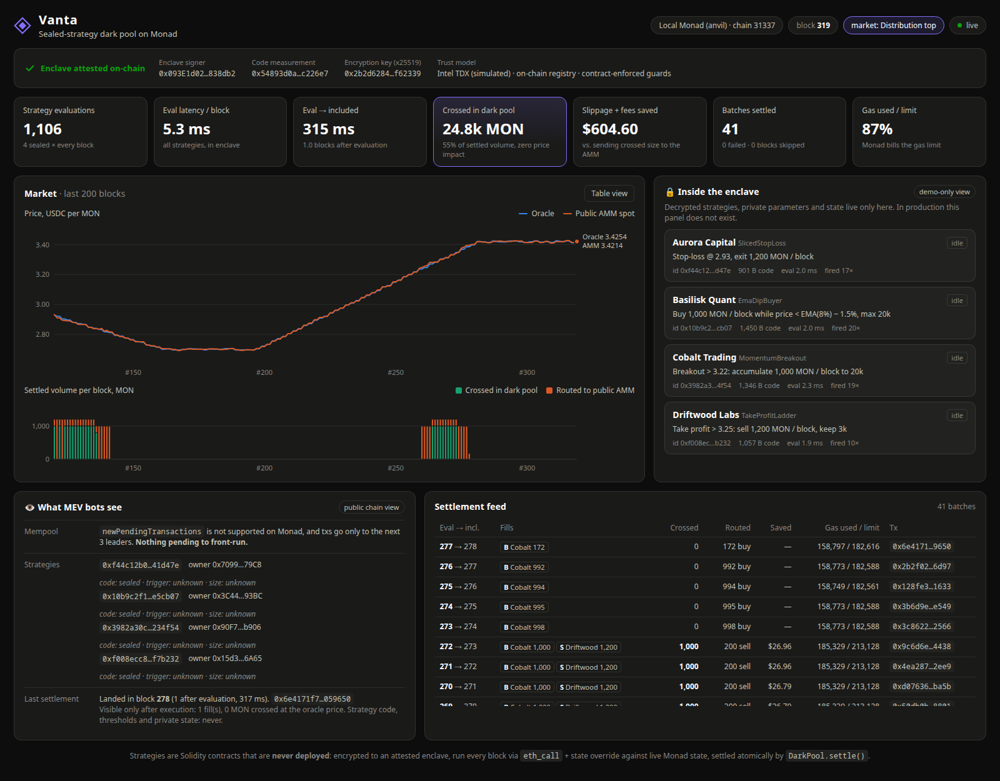

# Vanta: sealed-strategy dark pool on Monad

> **The FPGA in the colo, rebuilt for Web3.** Trading firms write their strategies as Solidity contracts that are **never deployed**. The code is encrypted to an attested enclave, which runs every strategy against live Monad state **every block (300 ms)**. The enclave crosses opposite orders internally at the oracle price and settles everything in one atomic, guard-railed transaction.

MEV bots can't front-run a trigger they can't read, and they can't sandwich a trade that never touches a public pool.



**Demo:** the hosted hackathon deployment is closed; [DEPLOY.md](DEPLOY.md) shows how to run your own. In the app, click **＋ Bring your strategy** to compile, seal and run your own Solidity strategy from the browser. The presenter script is in [docs/DEMO.md](docs/DEMO.md).

## Why

On a public chain, a "conditional order" contract publishes its own alpha:

- **Stop levels and thresholds are readable.** Anyone can simulate the trigger and get in first.
- **Executions go to public AMMs**, where they are sandwichable.
- **Shielded pools like Railgun hide *who* trades, not *what* or *when*.** The swap is still public at execution, and Railgun isn't on Monad anyway.

The research and design trade-offs are in [RESEARCH.md](RESEARCH.md).

## How it works

```
 Firm (Solidity strategy)                       Vanta enclave (TEE, simulated)             Monad
 ────────────────────────                       ──────────────────────────────             ─────
 1. read enclave key + attestation ◀────────────────────────────────────────────── EnclaveRegistry
 2. seal(code ‖ params) → enclave key ─────────▶ decrypt in memory only
 3. registerStrategy(keccak(code ‖ params)) ───────────────────────────────────────▶ DarkPool (hash only)
                                                 every new block:
                                                   eth_call + state override:
                                                   strategy.check(ctx, privateState)
                                                   → orders, new private state
                                                   sign Batch(fills, price, validUntil) ──▶ DarkPool.settle()
                                                                                             • attested signer?
                                                                                             • oracle band, expiry, replay
                                                                                             • per-firm risk limits
                                                                                             • CROSS opposite flow @ oracle
                                                                                             • route residual → AMM w/ minOut
```

- **Code that is never deployed.** The enclave runs each strategy's runtime bytecode with `eth_call` and a state override at a phantom address. It reads the same live state a deployed contract would, but nothing is published.
- **Private state.** Each `check()` returns `newState`, which the enclave keeps between blocks. The dip-buyer's EMA lives only in the enclave.
- **Contract-enforced guards.** A compromised enclave still can't:
  - trade more than 1% off the oracle;
  - exceed a firm's own `maxNotionalPerBatch`;
  - replay a batch, or settle a stale one after `validUntilBlock`;
  - route more than 1.5% worse than the oracle.
- **Internal crossing is the dark pool.** Opposite orders in the same block settle as vault ledger transfers at the oracle price: no price impact and no AMM fee. Only the net residual touches the public AMM.
- **Monad-aware engine.**
  - Gas limit is set within 15% of the estimate, because Monad bills the gas limit, not gas used.
  - Nonces are tracked locally.
  - Expiry guards use `block.number`, because Monad timestamps only have 1 s granularity.
  - The engine reacts to proposed blocks, and the on-chain guards make a stale trigger revert instead of mis-filling.

## Repo layout

| Path | What |
|---|---|
| `contracts/src/DarkPool.sol` | Vault, strategy commitments, risk limits, batch settlement with internal crossing and residual routing |
| `contracts/src/EnclaveRegistry.sol` | Attested enclave keys (mock quote; production: Automata DCAP verifier for Intel TDX) |
| `contracts/src/interfaces/IStrategy.sol` | The interface firms implement |
| `contracts/src/strategies/` | Example sealed strategies: sliced stop-loss, EMA dip-buyer (stateful), momentum breakout, take-profit ladder |
| `contracts/src/mocks/` | Oracle (stands in for Pyth Pro), constant-product AMM (stands in for Kuru / Uniswap v4), tokens |
| `engine/src/enclave.ts` | **The enclave:** key generation, attestation quote, decryption, strategy execution, batch signing |
| `engine/src/engine.ts` | Host process: attestation, per-block loop, settlement, dashboard websocket |
| `engine/src/firms.ts` | Onboards four demo firms (seal → commit → upload) |
| `engine/src/sim.ts` | Scripted market: calm → sell-off → bottom → rally → top → revert |
| `dashboard/` | Live dashboard (vanilla JS + SVG) |

## Run the demo

Requirements: Foundry, Node ≥ 22.18. Node runs the `.ts` files directly, with no build step.

```bash
./scripts/demo.sh            # anvil @ 300 ms blocks → deploy → engine → firms → market sim
open http://127.0.0.1:8787   # dashboard
```

Contract tests:

```bash
cd contracts && forge test
```

### Suggested 3-minute pitch flow

1. **Attestation strip.** The enclave generated its keys inside and was registered on-chain against an approved code measurement. Firms fetched the encryption key from the chain, not from us.
2. **"What MEV bots see".** Four strategies are on-chain as bare hashes. Monad has no public mempool to watch (`newPendingTransactions` isn't supported).
3. **"Inside the enclave".** The same four strategies, decrypted and each evaluated in about 2 ms every block. This panel is for the demo only.
4. **Sell-off.** Aurora's stop-loss fires, and Basilisk's dip-buyer fires on its private EMA. They **cross in the dark pool** (green bars) at the oracle price. Only the residual is routed (orange).
5. **Rally.** Cobalt's breakout buys while Driftwood takes profit, and they cross again.
6. **KPIs.** Each batch is included in the next block (~300 ms), with slippage and fees saved and 0 failed batches.
7. **Close on the guards.** Even a malicious enclave can't trade off-oracle or breach a firm's risk limit. See `forge test`: `test_revert_priceOutsideOracleBand` and `test_riskLimit_rejectsFillButBatchSettles`.

## Deploy: Monad testnet + GCP Cloud Run

One funded testnet wallet is enough. Every other role (relayer, market sim, four firms) gets a key derived from it.

```bash
cp engine/.env.testnet.example engine/.env.testnet       # put MASTER_PK in it (gitignored)
./scripts/deploy-testnet.sh                              # simulate: gas + MON estimate
./scripts/deploy-testnet.sh --yes                        # deploy → deployments/10143.json
cd engine && NETWORK=testnet node src/fund.ts            # plan top-ups of the role wallets
NETWORK=testnet node src/fund.ts --yes                   # send them
cd .. && GCP_PROJECT=<id> ./scripts/deploy-gcp.sh        # Cloud Run, 1 always-on instance
```

**Engine behaviour when hosted (`NETWORK=testnet`):**
- **One `eth_call` per block.** Oracle, AMM and all strategies go through Multicall3, so the engine stays under the public RPC's rate limit.
- **Block updates over websockets.**
- **Re-onboards the demo firms on every boot.** Enclave keys are fresh each boot.
- **Spends MON only on demand.** The market scenario starts only from the dashboard's **Run market scenario** button, shown when you open `/?admin=<ADMIN_TOKEN>`. One cycle costs ≈ 4–5 MON on testnet (relayer ≈ 2.5, sim ≈ 2); top up with `fund.ts`.

**Where secrets live:** keys and the admin token go to Secret Manager and are never put in the image.

## Hackathon shortcuts (and the production path)

| Shortcut here | Production |
|---|---|
| Enclave is a normal Node process | Same code in an Intel TDX confidential VM (Phala dstack), co-located with a Monad full node reading the Execution Events SDK |
| Mock attestation quote | Verify the TDX DCAP quote on-chain (Automata) and bind `reportData` to the signer and encryption key |
| Measurement = hash of the enclave source | Reproducible-build image measurement (MRTD/RTMR) |
| MockOracle + SimpleAMM | Pyth Pro / RedStone Bolt feeds, with residual routing to Kuru / Uniswap v4 |
| Single pair, single enclave | Multi-pair, multiple independent enclave operators, firm-hosted enclaves |
| Fills reveal firm accounts after execution | Fund vault accounts through Unlink (Monad's shielded pool) to break identity links |
| Residual still hits a public AMM | Monad's BTX encrypted mempool / Monad Private Settlement when they ship |

**Honest threat model:** the TEE protects strategy confidentiality. Someone with physical access to the machine could still extract strategies (TEE.fail, 2025). Fund safety does not depend on the TEE; it depends on the on-chain guards.
